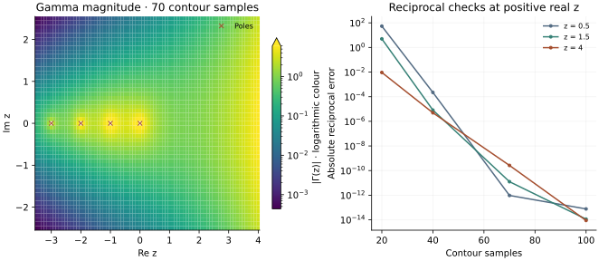

<!-- SPDX-FileCopyrightText: 2026 VTT Technical Research Centre of Finland Ltd -->
<!-- SPDX-License-Identifier: AGPL-3.0-or-later -->

::: {.article-body}
::: {.article-title}
[OpenPFC / Operators and their solutions]{.lesson-kicker}

# A contour turns an integral into a sum

[Use complex arithmetic and a shifted trapezoidal rule to approximate reciprocal gamma, while keeping poles and branch choices explicit.]{.lesson-deck}
:::

Program 31 of @trefethen2000 draws the complex gamma function using a short
contour sum. The underlying identity is Hankel's representation of the
reciprocal gamma function, documented in @nistgamma:

$$\frac1{\Gamma(z)}=\frac1{2\pi i}\int_{-\infty}^{(0+)} e^t t^{-z}\,dt.$$

The contour travels from the negative real axis, circles zero in the
positive direction and returns along the other side. A branch choice is
part of this formula, not an implementation afterthought.

## Parameterize once, then sample

Use the book's circle $t(\theta)=-11+16e^{i\theta}$. Since
$dt=i(t+11)\,d\theta$, a midpoint-shifted trapezoidal sum gives

$$
\begin{gathered}
G_N(z)=\frac1N\sum_{j=0}^{N-1}e^{t_j}t_j^{-z}(t_j+11), \\
\theta_j=-\pi+\frac{2\pi}{N}(j+\tfrac12).
\end{gathered}
$$

```{.cpp include="model.cpp" snippet="hankel"}
```

`std::complex` expresses the formula directly. The principal complex logarithm
and half-grid shift avoid evaluating exactly on the negative-real branch
cut. The finite circular path also truncates the two negative-axis tails.
Increasing N controls sampling error, not that independent contour truncation.
The sum is a mathematical reference using the standard library; it does not
claim a public OpenPFC special-function API.

{#fig-gamma}

## A pole is not a very large finite answer

```sh
openpfc run model.cpp input.json --launcher=none
```

The default uses 70 samples and the original complex rectangle. The CSV
records the raw reciprocal estimate and marks exact nonpositive-integer
poles on the real axis. Gamma magnitude there is NaN by design, rather
than a finite height obtained by dividing roundoff noise into one.
`results/convergence.csv` also includes 20,40,70,100-point sums at positive
real arguments with factorial and half-integer checks.

Conjugate symmetry is checked across the rectangle. The recurrence check
uses $0.5\le\Re z\le3$, so that $z+1$ stays in the output; its tolerance
reflects the 70-point quadrature. Real-axis checks require substantial
improvement from 40 to 70 samples, and agreement within $10^{-11}$ at
100 samples. The default experiment is not a uniform high-precision special
function implementation over the entire rectangle. Cancellation, branch-cut
tails and proximity to poles all affect the answer. This is an opportunity
to ask what each numerical limit actually controls.

The complete [C++ model](model.cpp) and [starting input](input.json)
are available with this lesson.

## References
::: {#refs}
:::
:::
