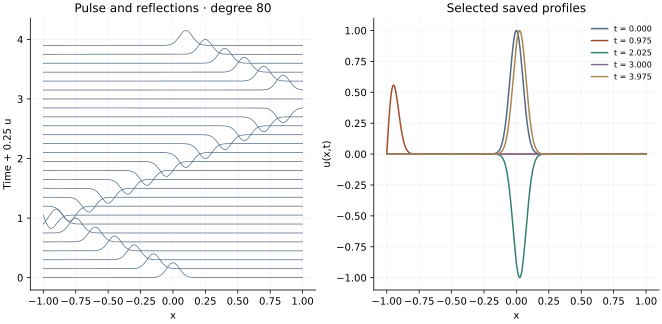

<!-- SPDX-FileCopyrightText: 2026 VTT Technical Research Centre of Finland Ltd -->
<!-- SPDX-License-Identifier: AGPL-3.0-or-later -->

::: {.article-body}
::: {.article-title}
[OpenPFC / Waves and boundaries]{.lesson-kicker}

# A pulse meets the end of an interval

[The FFT can differentiate a polynomial on a finite interval. The trick is to change the coordinate, not the boundary condition.]{.lesson-deck}
:::

Consider the wave equation

$$
\begin{gathered}
u_{tt}=u_{xx}, \\
-1<x<1.
\end{gathered}
$$ {#eq-wave}

Program 19 of @trefethen2000 starts with the narrow pulse
$u(x,0)=\exp(-200x^2)$ on $x_j=\cos(j\pi/N)$, with $N=80$.
The pulse initially travels left, meets a fixed endpoint and reflects.
This is a finite-interval problem even though its derivatives use an FFT.

## Turn a polynomial into a cosine series

Write $x=\cos\theta$. The degree-$N$ interpolant becomes
$p(\cos\theta)=\sum_{k=0}^N a_k\cos(k\theta)$.
An even extension of the samples has length $2N$, so OpenPFC's
`LocalFFT` can find these coefficients. For interior points,

$$
p''(x)=\frac{p_{\theta\theta}}{\sin^2\theta}
       -\frac{\cos\theta\,p_\theta}{\sin^3\theta}.
$$ {#eq-chain}

```{.cpp include="../lesson.hpp" snippet="cosine" dedent=2}
```

The odd derivative sets the Nyquist multiplier to zero. The second
derivative retains it. At the two endpoints the helper uses the exact
polynomial limits $T'_k(1)=k^2$ and
$T''_k(1)=k^2(k^2-1)/3$, with the appropriate signs at $-1$.
Dividing by a tiny sine there would magnify roundoff.

The book calls `chebfft` twice. Applying the chain rule directly gives
the same second derivative of the interpolating polynomial, using one
forward and two inverse transforms. This example-owned mapping is not
a public OpenPFC nonuniform-grid operator.

## Remember two time levels

Leapfrog for @eq-wave uses

$$
u^{m+1}=2u^m-u^{m-1}+\Delta t^2D_{xx}u^m.
$$ {#eq-leapfrog}

```{.cpp include="model.cpp" snippet="leapfrog" dedent=4}
```

Endpoint acceleration is zero, as in the original program. The supplied
two endpoint levels therefore determine a linear-in-time endpoint value.
For this Gaussian their magnitudes are about $10^{-87}$; this is an
excellent approximation to fixed zero ends, but it is useful to say what
the recurrence actually imposes.

{#fig-pulse}

## The previous level is an initial condition

The default `startup: "book"` uses the original
$u^{-1}_j=\exp[-200(x_j-\Delta t_{\rm nominal})^2]$.
It approximates initial velocity $u_t(x,0)=u_x(x,0)$.
The output interval is .075; rounding the number of steps gives
$\Delta t=.00125$. Rounding the number of frames makes the actual final
time **3.975**, rather than 4. Every CSV row records its actual time.

Set `startup: "taylor"` to use
$u^{-1}=u^0-\Delta t\,u_t^0+\tfrac12\Delta t^2D_{xx}u^0$.
This uses the adjusted timestep consistently. Set `initial: "mode"`
as well to start with $\cos(\pi x/2)$ and zero velocity. Then compare
with the exact solution $\cos(\pi x/2)\cos(\pi t/2)$.
At a resolved spatial degree, halving the Taylor-started timestep
should reduce the temporal error by about four.

## Run and change it

```sh
openpfc run model.cpp input.json --source-root .. --launcher=none
```

`results/wave.csv` contains all nodes at every saved level. Try changing
`n`, then predict why an endpoint-clustered grid needs
$\Delta t=O(N^{-2})$ for an explicit wave equation.
The program bounds the adjusted step by `dt*n*n <= 8`.
This complete-domain reference runs on one process.

Keep the [C++ model](model.cpp), [input](input.json) and
[theme helper](../lesson.hpp) together. Continue with
[a square wave problem](../chebyshev-square/index.qmd).

## References
::: {#refs}
:::
:::
