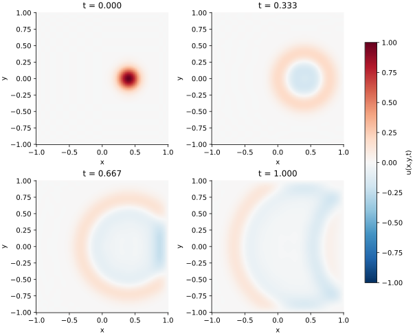

<!-- SPDX-FileCopyrightText: 2026 VTT Technical Research Centre of Finland Ltd -->
<!-- SPDX-License-Identifier: AGPL-3.0-or-later -->

::: {.article-body}
::: {.article-title}
[OpenPFC / Waves and boundaries]{.lesson-kicker}

# Let a wave spread across a square

[A two-dimensional Laplacian is the sum of two one-dimensional operations. Keep that structure visible in the code.]{.lesson-deck}
:::

A pulse spreads and reflects in $[-1,1]^2$:

$$
\begin{aligned}
u_{tt}&=u_{xx}+u_{yy},\\
u(x,y,0)&=\exp\{-40[(x-.4)^2+y^2]\}.
\end{aligned}
$$ {#eq-wave}

Program 20 of @trefethen2000 uses degree 24 in each coordinate and
leapfrog in time. Both spatial coordinates are Chebyshev coordinates.
Its title says "via FFT" because cosine-mapped differentiation uses
transforms; the physical square is not periodic.

## Reuse a line derivative in two directions

The [one-dimensional lesson](../chebyshev-line/index.qmd) derives the
even extension and the chain rule. Here the same helper acts on every
interior row and column:

```{.cpp include="model.cpp" snippet="tensor" dedent=4}
```

Only interior acceleration is filled. The full state still contains
the boundary samples needed by the interpolating polynomial. With
$u^{-1}=u^0$, zero boundary acceleration preserves their initial values.
Those Gaussian tails are small, but not exactly zero: the largest is
about $5.6\times10^{-7}$. We retain them to reproduce the original
discrete problem.

This tensor application costs $O(N^2\log N)$ and stores $O(N^2)$
field values. It avoids constructing a square two-dimensional derivative
matrix. The helper creates its FFT plan once and reuses it for every line.

## Advance the field after calculating its whole acceleration

```{.cpp include="model.cpp" snippet="leapfrog" dedent=4}
```

Two swaps rotate the three buffers. Every derivative sees the complete
old field; an in-place cell-by-cell update would change the method.
The original $\Delta t=6/N^2$ divides the output interval $1/3$ into
32 steps, giving $\Delta t=1/96$ and snapshots at 0, 1/3, 2/3 and 1.

{#fig-wave}

The book uses cubic interpolation for its display. This figure evaluates
the saved degree-24 polynomial barycentrically in both directions.
The fine display grid does not increase the simulation's resolution.

## Ask what zero velocity means numerically

The default `startup: "book"` sets $u^{-1}=u^0$. In the first update this
gives $u^1=u^0+\Delta t^2\Delta_hu^0$. A Taylor expansion for zero initial
velocity has half that acceleration term. Consequently the book startup
introduces a first-order initial-velocity error.

Use `startup: "taylor"` for
$u^{-1}=u^0+\tfrac12\Delta t^2\Delta_hu^0$.
With `initial: "mode"`, the continuum answer is

$$
u(x,y,t)=\cos(\pi x/2)\cos(\pi y/2)
          \cos(\pi t/\sqrt2).
$$ {#eq-exact}

Compare both startups at two timesteps. The spatial operator and
leapfrog recurrence stay the same; the initial level explains the
different convergence rates.

## Run and inspect

```sh
openpfc run model.cpp input.json --source-root .. --launcher=none
```

`results/wave.csv` contains all $(N+1)^2$ samples per saved time.
The model checks `dt*n*n <= 6` after output-time adjustment and runs
on one process. Keep the [source](model.cpp), [input](input.json) and
[shared FFT helper](../lesson.hpp) together.
Next combine periodic and reflecting directions.

## References
::: {#refs}
:::
:::
