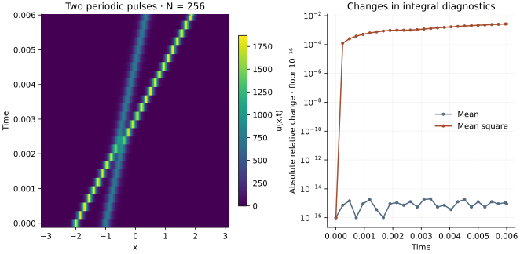

<!-- SPDX-FileCopyrightText: 2026 VTT Technical Research Centre of Finland Ltd -->
<!-- SPDX-License-Identifier: AGPL-3.0-or-later -->

::: {.article-body}
::: {.article-title}
[OpenPFC / Nonlinear waves]{.lesson-kicker}

# Let dispersion evolve exactly between stages

[A stiff linear oscillation has a known solution. Factor it out and let Runge–Kutta handle the nonlinear part.]{.lesson-deck}
:::

The Korteweg–de Vries equation combines nonlinear steepening with
dispersion:

$$
\begin{gathered}
u_t+u\,u_x+u_{xxx}=0, \\
-\pi\le x<\pi.
\end{gathered}
$$ {#eq-kdv}

Program 27 of @trefethen2000 starts two narrow solitary-wave profiles
with amplitudes $3A^2$ and $3B^2$, where $A=25$ and $B=16$.
Their centres are initially $-2$ and $-1$. The larger pulse moves faster,
catches the smaller one and emerges from the interaction.
The finite periodic domain and sampled initial data define a numerical
experiment; an isolated infinite-line soliton is not an exact answer to
this two-pulse periodic initial-value problem.

## Separate the Fourier equation

Using $\widehat{\partial_xu}_k=ik\hat u_k$ gives

$$
\frac{d\hat u_k}{dt}=ik^3\hat u_k-\frac{ik}{2}\widehat{u^2}_k.
$$ {#eq-fourier}

Set $L_k=ik^3$ and $v_k(t)=e^{-tL_k}\hat u_k(t)$. Then

$$
\begin{aligned}
v'_k&=e^{-tL_k}\mathcal N_k(e^{tL}v),\\
\mathcal N_k(\hat u)&=-\frac{ik}{2}
\mathcal F\{[\mathcal F^{-1}\hat u]^2\}_k.
\end{aligned}
$$ {#eq-factor}

This is an ordinary, time-dependent ODE for complex coefficients.
OpenPFC's `ExplicitRKStepper` accepts a complex scalar state and a real
RK4 tableau:

```{.cpp include="model.cpp" snippet="factor" dedent=4}
```

`LocalFFT` has an unscaled forward transform and a normalized inverse.
No extra factor of $N$ belongs in the product. Its half-spectrum stores
the Hermitian coefficients of a real field. Both odd multipliers use
zero at the Nyquist mode, matching the original program.

The book writes its integrating-factor RK4 stages explicitly, resetting
the factor each step. Here the public RK4 stepper integrates the global
transformed variable. These are algebraically equivalent updates, with
different floating-point roundoff. An independent reference checks the
original full-complex-FFT stage formula.

```{.cpp include="model.cpp" snippet="evolve" dedent=4}
```

{#fig-kdv}

## Preserve the distinction between a method and an invariant

The zero nonlinear multiplier preserves the mean coefficient. The
continuum equation also conserves $\int u^2\,dx$. A finite timestep and
an aliased pointwise product need not preserve that second quantity
exactly. The diagnostic CSV records both; it does not enforce them.
The displayed $N=256$ run changes the mean square by a few parts per
thousand. This is a reason to compare grid and timestep refinements,
even though the mean remains at roundoff accuracy.

The original experiment uses $N=256$, $\Delta t=.4/N^2$ and final time
.006. It does **not** de-alias the product. This reproduction keeps
that choice visible. Adding padding or a mode filter changes the
discrete method and should be compared explicitly.

## Try a problem with a known answer

Set `initial: "cosine"` and `nonlinearity: 0`. Dispersion alone then
gives $u(x,t)=\cos(2x+8t)$. The transformed state is constant, so RK4
adds no time-discretization error to this linear check.
With `initial: "constant"`, both derivatives vanish and the full
nonlinear problem should preserve the constant field.

For the nonlinear interaction, halve `dt` while keeping the same grid
and compare the whole final field. Refining only the step cannot remove
spatial truncation or aliasing errors.

```sh
openpfc run model.cpp input.json --source-root .. --launcher=none
```

The complete-domain example runs on one process. It saves all physical
nodes in `results/kdv.csv` and integral diagnostics in
`results/diagnostics.csv`. The last step is always saved, even when it
does not coincide with `save_every`. Step counts round `end/dt`, and
every output includes its actual time.

Keep the [model](model.cpp), [input](input.json) and
[shared I/O helper](../lesson.hpp) together. Compare the integrating
factor with [ETD step doubling](../../integration/adaptive-etd/index.qmd):
both use linear exponentials, but their nonlinear stage formulas differ.

## References
::: {#refs}
:::
:::
