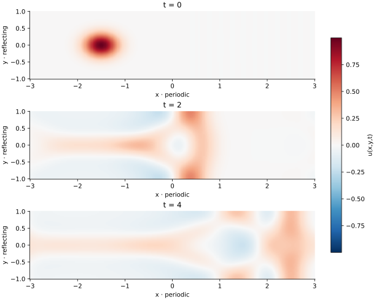

<!-- SPDX-FileCopyrightText: 2026 VTT Technical Research Centre of Finland Ltd -->
<!-- SPDX-License-Identifier: AGPL-3.0-or-later -->

::: {.article-body}
::: {.article-title}
[OpenPFC / Waves and boundaries]{.lesson-kicker}

# A wave tank has two kinds of edge

[Use the representation that fits each coordinate. Periodicity in one direction does not require periodicity in every direction.]{.lesson-deck}
:::

The wave tank in program 37 of @trefethen2000 solves

$$
\begin{gathered}
u_{tt}=u_{xx}+u_{yy},\\
(x,y)\in[-A,A]\times[-1,1],\\
u_y(x,\pm1,t)=0.
\end{gathered}
$$ {#eq-tank}

The $x$ direction is periodic; the top and bottom are reflecting walls.
The original values are $A=3$, $N_x=50$ Fourier points and degree
$N_y=15$ in the Chebyshev direction. A displaced Gaussian launches a
predominantly right-moving disturbance.

## Let each coordinate keep its representation

For each row, the Fourier multiplier is $-(\pi k/A)^2$.
For each column, differentiate the polynomial on $y_j=\cos(j\pi/N_y)$.

```{.cpp include="model.cpp" snippet="mixed" dedent=4}
```

The original program builds two dense differentiation matrices.
Here both actions use native `LocalFFT` plans and the
[example-owned cosine map](../chebyshev-line/index.qmd).
They differentiate the same Fourier and polynomial interpolants, up to
floating-point arithmetic. No public curvilinear-grid or distributed
mixed-transform API is being assumed.

## Solve two endpoint equations

Let $D$ be the first derivative in $y$, $I$ the interior nodes and
$B=\{0,N_y\}$ the two endpoints. The wall equations are

$$
D_{BB}u_B=-D_{BI}u_I.
$$ {#eq-wall}

The endpoint rows of $D$ are obtained by differentiating basis sample
vectors once during setup. A two-by-two solve then reconstructs both
boundary values after every step:

```{.cpp include="model.cpp" snippet="boundary" dedent=4}
```

This imposes zero derivative, not zero value. Setting the endpoints
themselves to zero would change the wall's reflection behaviour.

```{.cpp include="model.cpp" snippet="leapfrog" dedent=4}
```

{#fig-tank}

## Read the first two levels carefully

The original initial field is $\exp[-8((x+1.5)^2+y^2)]$ and its previous
level shifts $x$ by the nominal timestep $5/(N_x+N_y^2)$.
The output scheduler subsequently adjusts the step to $2/110$.
The `book` startup preserves this order and reconstructs the wall values
after the first update, just as the original does. Its Gaussian initial
level is not already an exact Neumann interpolant.

The `taylor` startup first reconstructs the initial boundary, then uses
the adjusted step in a second-order previous level. With
`initial: "mode"`, its initial velocity is zero and the exact continuum
solution is

$$
\begin{gathered}
u=\cos(\pi x/A)\cos(\pi y)\cos(\omega t), \\
\omega^2=(\pi/A)^2+\pi^2.
\end{gathered}
$$ {#eq-mode}

This mode checks the physical Fourier scale, both spatial derivatives,
the wall equations and the time integrator together. The regression
checks also compare every sample of the original Gaussian experiment
with independently assembled dense derivative matrices on a small grid.

## Run and experiment

```sh
openpfc run model.cpp input.json --source-root .. --launcher=none
```

`results/wave.csv` records all nodes at each saved time. Change `nx`,
`ny` or `half_length`, then predict which direction restricts the step.
The example bounds the magnitude of the reduced Neumann operator by its
maximum absolute row sum, adds the largest Fourier squared frequency,
and requires $\Delta t^2\,\mathrm{bound}<4$. For a real negative
spatial eigenvalue $-\lambda$, leapfrog needs
$\Delta t\sqrt\lambda<2$. It is a serial teaching implementation.

Download the [source](model.cpp), [input](input.json) and
[theme helper](../lesson.hpp). For a nonlinear periodic wave, continue
with [KdV](../kdv/index.qmd).

## References
::: {#refs}
:::
:::
