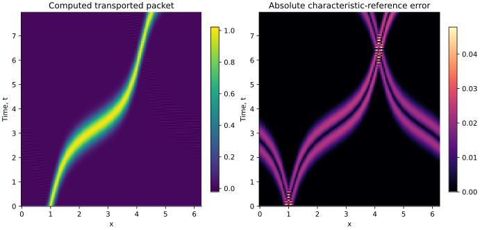

<!-- SPDX-FileCopyrightText: 2026 VTT Technical Research Centre of Finland Ltd -->
<!-- SPDX-License-Identifier: AGPL-3.0-or-later -->

::: {.article-body}
::: {.article-title}
[Waves / Following a characteristic]{.lesson-kicker}

# A wave changes speed

[A spatially varying coefficient turns a translating packet into a lesson about characteristics, resolution and time integration.]{.lesson-deck}
:::

The heat lessons smooth a field. Transport moves its values along
characteristics instead. Program 6 of @trefethen2000 uses Fourier
differentiation and leapfrog for the periodic problem

$$
\begin{gathered}
u_t+c(x)u_x=0, \\
c(x)=0.2+\sin^2(x-1), \\
u(x,0)=e^{-100(x-1)^2}, \\
0\le x<2\pi.
\end{gathered}
$$ {#eq-transport}

We reproduce that equation and add an exact characteristic reference.
The Gaussian is periodically extended. Its endpoint mismatch is below
$4\times10^{-44}$, but it is not literally an analytic periodic Gaussian.
The alternative cosine input is exactly periodic and useful for order checks.

## Values travel; speeds vary

Along $x'(t)=c(x(t))$, the chain rule gives
$d u(x(t),t)/dt=0$. The value is constant along the trajectory even while
the packet stretches or compresses in physical coordinates. This is the
nonconservative transport equation. Replacing $c u_x$ with $(cu)_x$
would add $c' u$ and define a different physical problem.

For $a=0.2$, introduce a phase

$$
\begin{gathered}
\phi(x)=\operatorname{atan2}\!\left(\sqrt{a+1}\sin(x-1),
                                      \sqrt a\cos(x-1)\right), \\
\phi'(x)=\frac{\sqrt{a(a+1)}}{c(x)}.
\end{gathered}
$$ {#eq-phase}

Consequently $\phi(x(t))$ increases at the constant rate
$\omega=\sqrt{a(a+1)}$. Subtracting $\omega t$, inverting the angular
map and wrapping the result into the interval gives the characteristic
foot $x_0$. The exact solution is $u(x,t)=u(x_0,0)$:

```{.cpp include="model.cpp" snippet="characteristic" dedent=2}
```

The phase identity supplies a reference independently of the spectral
derivative and the numerical time integrator.

## A two-level method needs two states

Leapfrog approximates @eq-transport by

$$
u^{n+1}=u^{n-1}-2\Delta t\,c D_Nu^n.
$$ {#eq-leapfrog}

There are two time sequences to initialize. The default constructs an
approximate state at $-\Delta t$ from a second-order Taylor expansion:

$$
u(-\Delta t)=f+\Delta t\,cf'
 +\tfrac12\Delta t^2c(c'f'+cf'').
$$ {#eq-start}

The executable also offers the book's startup expression. It uses the
Gaussian shifted by $0.2h/4$, as initialized before the book adjusts its
timestep to the plotting interval. That expression does not equal the
consistent negative-time Taylor state in @eq-start. Keeping both options
visible lets us inspect the computational mode of a two-level scheme.

```{.cpp include="model.cpp" snippet="startup" dedent=4}
```

## Keep the spatial and temporal choices visible

```{.cpp include="model.cpp" snippet="leapfrog" dedent=4}
```

OpenPFC supplies the field, decomposition, FFT and requested x derivative.
The leapfrog update and variable coefficient remain ordinary C++.
All next values are computed before changing the current field. Copying
into its existing buffer also preserves the evaluator's storage binding.

For an even Fourier grid, a conservative leapfrog restriction is
$\Delta t\,c_{\max}N/2<1$. The executable rejects parameters that violate
it. Stability alone does not guarantee that a narrow Gaussian is resolved
or that the startup has suppressed the second temporal branch.

{#fig-transport}

## Run a short lesson or the book setup

```sh
openpfc run model.cpp input.json --launcher=none
openpfc run model.cpp trefethen-p6.json --launcher=none
```

The default uses the Taylor startup and ends at $t=0.5$. The book preset
uses $N=128$, the book startup, $\Delta t=0.0125$, and 636 steps ending
at $t=7.95$. Our periodic nodes begin at zero rather than $h$; the sample
ordering is cyclic, with the Gaussian's tiny seam difference described
above. These are mathematical reproductions and comparisons, not a
bitwise MATLAB port.

Each attempt writes time slices and the characteristic reference in
`results/transport_rank_<rank>.csv`. Try `"initial": "cosine"` and compare
two timesteps at the same final time. The test checks second-order
convergence for both constant and variable speed. Its independent Python
reference traces characteristics with a small-step RK4 ODE integration,
without using the C++ angular transformation.

Then compare the two startups with the Gaussian. Inspect successive
steps as well as a distant final frame: a two-step oscillation can hide
in an attractive space-time plot. For the continuous equation the weighted
integral $\int u/c\,dx$ is conserved, whereas $\int u\,dx$ generally is not.

Continue with [stability regions](../../integration/stability/index.qmd).

The complete [C++ model](model.cpp) and [starting input](input.json)
are available with this lesson.
Use the [program 6 preset](trefethen-p6.json) for the book's Gaussian experiment.

## References
::: {#refs}
:::
:::
